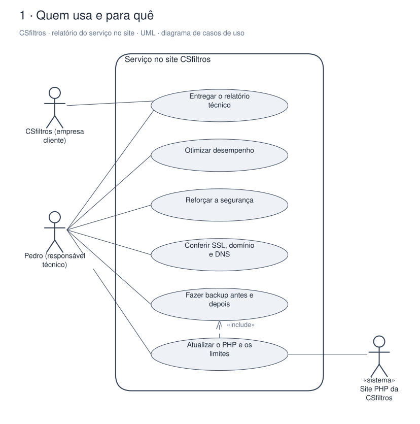
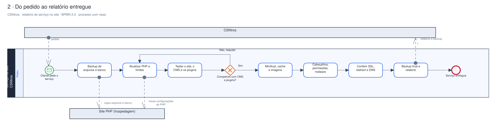
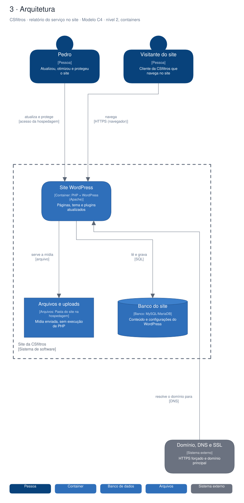

# Arquitetura

Diagramas gerados a partir do Sinapse (o segundo cérebro do Pedro). Cada projeto tem três vistas,
cada uma numa notação padrão:

1. **Quem usa e para quê**: UML, diagrama de casos de uso.
2. **O processo principal**: BPMN 2.0, com raias por quem executa.
3. **A arquitetura**: modelo C4, nível 2 (containers).

## CSfiltros · relatório do serviço no site

Relatório técnico do serviço feito no site WordPress da CSfiltros em maio de 2025: atualização do PHP, ganho de desempenho e reforço de segurança. O desenho mostra o serviço prestado e o site em que ele foi aplicado.

### Quem usa e para quê (UML)

### Do pedido ao relatório entregue (BPMN 2.0)

### Arquitetura (C4, containers)

Editável: [`relatorio-servi-o-csfiltros.excalidraw`](./relatorio-servi-o-csfiltros.excalidraw), abre em [excalidraw.com](https://excalidraw.com) ou no VS Code com a extensão Excalidraw.

A fonte destes arquivos é o vault do Sinapse (`09-DESENHOS/`); alterações feitas aqui são sobrescritas na próxima publicação.
